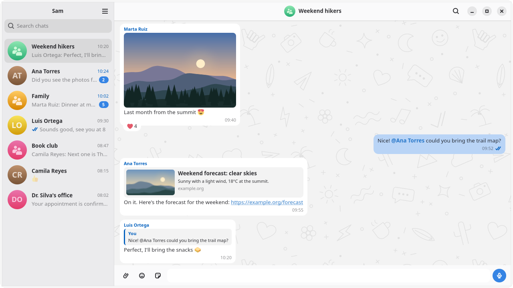

<p align="center">
  
</p>

<p align="center"><em>Unofficial native WhatsApp client for Linux.</em></p>

An **unofficial** WhatsApp client for Linux (GNOME), with a native protocol
implementation and low RAM usage.

> Early development. The first release is an RPM for Fedora 44; other
> distributions build it from source.

**Warning:** since this is an unofficial client, Meta could restrict accounts that use it. Try it with a secondary number first.

<p align="center">
  <picture>
    <source media="(prefers-color-scheme: dark)" srcset="data/screenshots/chat-dark.png">
    
  </picture>
</p>

## What it does

- Links your account by QR code, as another device of your phone, and
  brings in your recent history; older messages load as you scroll up.
- Sends and receives text, photos, videos, documents, stickers, GIFs and
  voice notes, with replies, reactions, link previews and mentions.
- Plays animated stickers and GIFs, and keeps your favorite stickers in
  sync with the phone.
- Shows delivery and read marks, unread counts, and profile and group
  pictures; keeps disappearing messages and locked chats as the phone does.
- Searches chats, and messages inside a chat.
- Notifies through the desktop even with the window closed, can hide the
  message text, and shows the unread count as a status icon.
- Follows the GNOME guidelines, works with the keyboard and screen readers,
  and is translated (Spanish so far).

It supports one account. What comes next is in
[`docs/roadmap.md`](docs/roadmap.md).

## Installing

Download the RPM from the
[releases page](https://github.com/MawCeron/Wassup/releases) and install it
on Fedora 44:

```sh
sudo dnf install ./wassup-*.x86_64.rpm
```

Open Wassup from the application launcher and scan the QR code with your
phone, as when linking any other device.

## How it works

Two processes talk over a Unix socket with Protocol Buffers:

- **`daemon/`**, in Go, uses [whatsmeow](https://github.com/tulir/whatsmeow)
  for the protocol and SQLite for storage. It runs as a systemd user
  service, so it keeps receiving messages when the UI is closed.
- **`ui/`**, in Rust, is a GTK 4 and libadwaita window that draws in software
  by default to save memory.

## Memory

With a real account of 29 chats and about 3,500 messages and no chat open,
the daemon and the UI together use about 64 MB (PSS), against 384 MB for
Whats4Linux and over 1 GB for the clients that wrap WhatsApp Web (1.3 GB
for Karere on the same account). The accounts differ in history, so read
it as an order of magnitude. Emoji are drawn with a bitmap font that the
package carries, because the default emoji font makes the UI grow by
hundreds of megabytes once emoji are shown. Method, caveats and every
figure are in [`docs/performance.md`](docs/performance.md).

## Contributing

See [`CONTRIBUTING.md`](CONTRIBUTING.md). Changes by release are in
[`CHANGELOG.md`](CHANGELOG.md).

## Building

Building the daemon and the UI for development is in
[`docs/development.md`](docs/development.md); building the RPM, in
[`docs/packaging.md`](docs/packaging.md).

## Documentation

- What is done and what comes next: [`docs/roadmap.md`](docs/roadmap.md).
- Development setup, configuration and how media works: [`docs/development.md`](docs/development.md).
- Building the RPM: [`docs/packaging.md`](docs/packaging.md).
- Translating: [`docs/translating.md`](docs/translating.md).
- IPC between the daemon and the UI: [`docs/ipc.md`](docs/ipc.md).
- Memory measurements: [`docs/performance.md`](docs/performance.md).
- Icons and look: [`docs/visual-identity.md`](docs/visual-identity.md).

Copyright © 2026 Mauricio Cerón Medina. Licensed under the [GNU GPL v3 or later](LICENSE).
